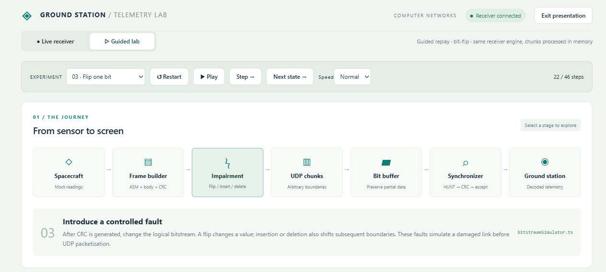
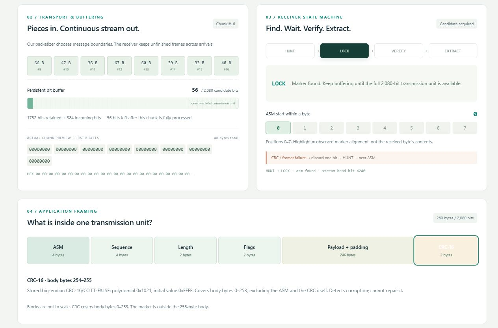
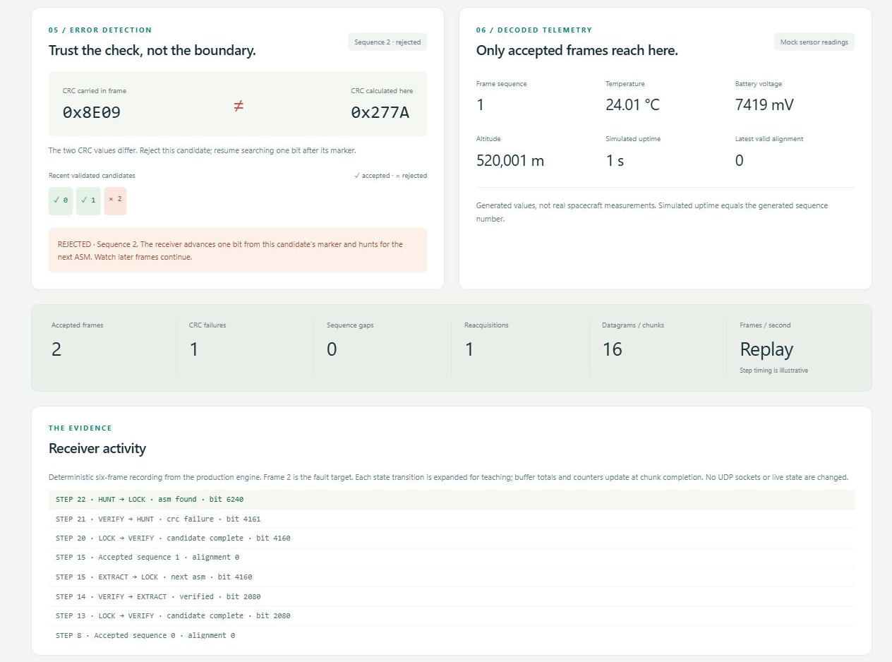
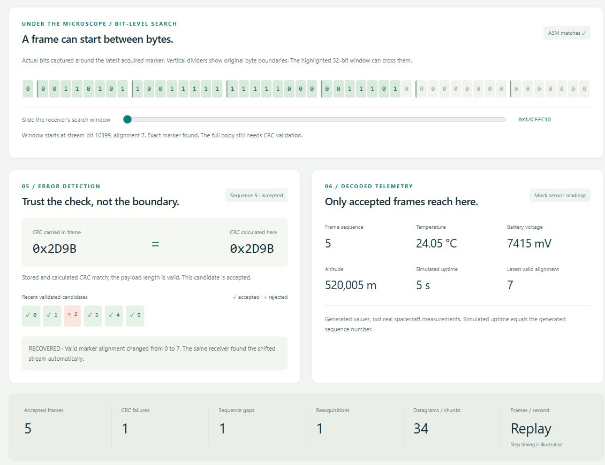

# Dashboard screenshots

These are captured views of the implemented dashboard. The insertion and deletion
views were captured on 20 October 2026. The other three views were captured on
21 October 2026. They illustrate the guided lab, which records six generated
frames through the production receiver engine in memory. Live UDP is verified
separately by the automated integration tests.

## Transmission pipeline

Transmission pipeline and guided experiment controls.

## Buffer and frame layout

Persistent buffering, receiver state and the transmission unit field layout.

## CRC rejection

Sequence 2 is rejected because the stored CRC is 0x8E09 and the calculated CRC is 0x277A.

## Insertion recovery

After one inserted bit, five frames are accepted and later valid alignment changes from 0 to 1.

## Deletion recovery

After one deleted bit, five frames are accepted and later valid alignment changes from 0 to 7.
